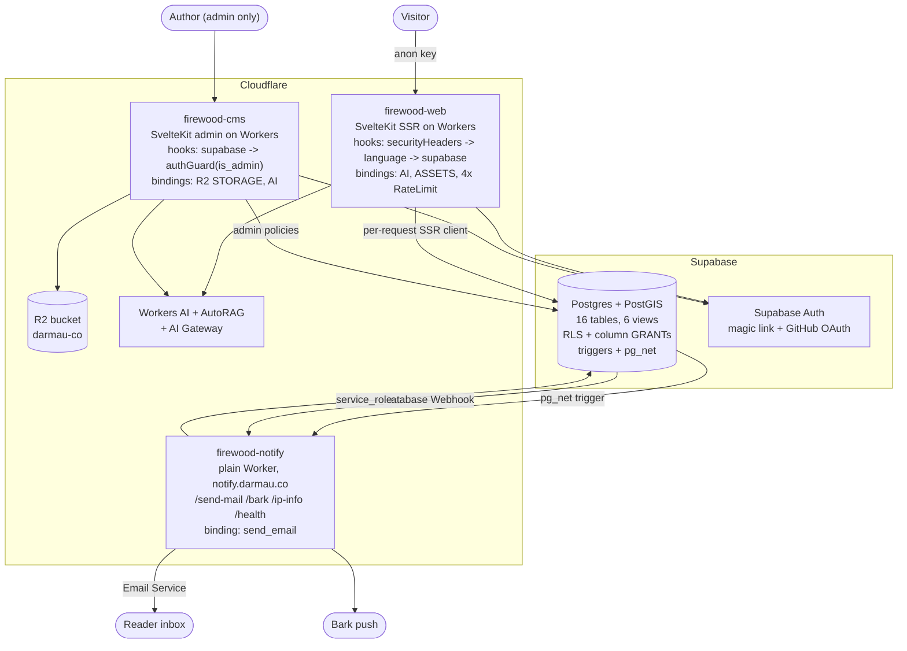

# darmau.co — Project Technical Dossier

> Prepared for job search. Every technical claim below is anchored to a file path,
> line number, commit hash, or a command that can be re-run against this repository.
> Claims that could not be verified from code are marked `⚠️ unverified`.
>
> Repository: `github.com/darmau/darmau-co` (public) · Live site: `https://darmau.co`
> Dossier generated 2026-09-15 against `main` @ `25682a5`.

---

## 1. Project at a glance

**One line:** A trilingual (Chinese / English / Japanese) publishing platform (public
site, authoring back office, notification service, and the database schema that binds
them) running end to end on Cloudflare's serverless edge runtime, with Postgres as the
single source of truth.

**Background in three lines.** The site publishes long-form essays, photo essays with
EXIF and map data, short notes, and a reading log, each in up to three languages. It
started in May 2024 as a React Router 7 app, ran that way in production for over a year,
and was rewritten to SvelteKit in August 2026 after an abandoned Astro migration. The
same August, three separate repositories were merged into one monorepo and the database
went through a security and integrity overhaul that closed two privilege-escalation
class defects.

**My role:** sole engineer and designer. 502 of 503 commits are mine; the remaining one
is a bot commit from an Astro template (`git log --format='%an' main | sort | uniq -c`).
I owned product decisions, data modeling, UI design, implementation, and deployment.

**Timeline:** first commit `3ac1efd` 2024-05-16, latest `25682a5` 2026-08-08. Calendar
span is 27 months, but work came in four bursts rather than continuously:

| Period | Commits | What happened |
| --- | --- | --- |
| 2024-05 → 2024-09 | 225 | React Router 7 front end + SvelteKit CMS built and shipped |
| 2025-10 → 2025-12 | 159 | Reactions, gallery feed, album map, Playwright setup |
| 2026-05 (one day) | 52 | Astro 6 + React Islands migration, later abandoned |
| 2026-08 | 66 | Monorepo merge, security/DB overhaul, SvelteKit rewrite |

`git log --format='%ad' --date=format:'%Y-%m' main | sort | uniq -c`

**Scale (measured, not estimated).** Generated files (`worker-configuration.d.ts`,
the generated Supabase types, the legacy schema snapshot) are excluded from the source
count and listed separately.

| Metric | Value | How it was obtained |
| --- | --- | --- |
| Commits on `main` | 503 | `git log --oneline main \| wc -l` |
| Tracked files | 574 | `git ls-files \| wc -l` |
| Hand-written source | 37,917 lines | `git ls-files \| grep -E '\.(ts\|svelte\|astro\|js\|sql\|css)$' \| <exclude generated> \| xargs wc -l` |
| - `apps/web` | 16,649 | same, path-filtered |
| - `apps/cms` | 17,153 | same |
| - `apps/notifier` | 732 | same |
| - `apps/minimalist` | 1,384 | same |
| - `packages/database` | 1,806 (1,499 of it SQL migrations) | same |
| - `packages/shared` | 193 | same |
| Generated, checked in | 11,130 | `worker-configuration.d.ts` 9,094 + `packages/database/src/index.ts` 2,036 |
| Project docs | 1,750 lines of Markdown | `git ls-files '*.md' \| grep -v .agents/skills \| xargs wc -l` |
| Automated tests | 56 cases, 732 lines | count of `it(`/`test(` across 10 test files |
| SQL behaviour assertions | 19 | `grep -c "as check" packages/database/supabase/tests/02_assert.sql` |

> **Caveat worth knowing before an interview.** The clone this dossier was generated
> from arrived shallow (133 commits). `git fetch --unshallow` recovered the real 503.
> If someone clones with `--depth`, the history numbers will look wrong.

---

## 2. Business and requirements

**The real constraints.**

1. *Trilingual is not a feature, it is the data model.* Every article, album, category,
   and note exists per language. URLs carry a language segment. Feeds, sitemaps, and
   `hreflang` are per language. A visitor arriving without a language prefix has to be
   routed by `Accept-Language` (`apps/web/src/hooks.server.ts:35-52`).
2. *One person writes and one person maintains.* There is no ops team. Anything that
   needs a runbook has to have the runbook committed next to it
   (`packages/database/README.md`, `apps/notifier/README.md`).
3. *The repository is public.* No secret can live in a config file. The public site
   reads every secret at runtime from `platform.env`, populated by `wrangler secret put`
   (`apps/web/src/hooks.server.ts:57-60`, `apps/web/wrangler.jsonc:59-62`). CI uploads
   Playwright traces only on failure with 3-day retention because a trace carries the
   test account's session cookie and anyone can download a public repo's artifacts
   (`.github/workflows/ci.yml:76-83`).
4. *Photography means location data.* Albums carry EXIF and GPS. That is both a product
   feature (a map of every shot) and a privacy liability.
5. *Comments are a public write endpoint.* Anonymous visitors can post. That is the
   single most exposed surface in the system.

**Stakeholders:** me as author, and readers of the public site. No client, no team.

**Success criteria:** the site stays up and cheap, publishing does not lose work, and a
schema change can be made without guessing. The third one was not true until August 2026
and fixing it is the most substantial engineering work in the repository.

---

## 3. From requirement to abstraction

Three worked examples, each traced from the original need to the final data structure.

### 3.1 "Photo albums should be browsable on a map"

*Requirement.* Show every geotagged photo on a world map, clustered, filtered by the
current language.

*Naive shape.* Query `image` joined to `photo_image` joined to `photo`, filter by
language, then assemble GeoJSON in the Worker. That is three round trips and a
per-request transform of every row.

*What it became.* A Postgres function `get_photo_map_geojson(lang_code)` that returns a
finished GeoJSON `FeatureCollection` as a single `Json` value. The Worker's loader is
one RPC call and a cast (`apps/web/src/routes/[lang=lang]/albums/map/+page.server.ts:11-14`).
The shape the client needs is the shape the database returns. PostGIS is a project
dependency for exactly this (`geography_columns`, `geometry_columns` appear in the
generated types).

*What complexity it absorbed.* Language filtering, the photo/image join, the
lat/lng/ref normalization (`exif_coordinate_with_ref`), and the GeoJSON envelope all
live in one place instead of being reassembled in every caller.

### 3.2 "Saving an album must not be able to lose the album"

*Requirement.* An album is a photo record plus an ordered list of images. Editing one
means replacing the whole list.

*Naive shape, and the one that shipped first.* Three independent browser requests:
update the photo, delete every `photo_image` row for it, insert the new rows. If request
two succeeded and request three did not, the album's entire image list and ordering were
gone permanently, and the author saw an error toast.

*What it became.* A single `jsonb`-in, `bigint`-out Postgres function. The photo fields
arrive as one `jsonb` document, the image list as a `jsonb` array. The function does the
insert-or-update, the delete, and the re-insert in one transaction
(`packages/database/supabase/migrations/20260807040000_p2_save_photo_atomically.sql`).

*The modeling decisions inside it are the interesting part:*

- `security invoker` (line 31), so row-level security still applies. The function buys
  atomicity, not privileges.
- A zero-row update raises `42501` explicitly (line 88). PostgREST does not error when
  RLS filters an update to zero rows; without this the caller is told the save worked.
- `distinct on (image_id)` with `order by image_id, sort_order nulls last` (line 100).
  The composite primary key already forbids duplicates, so a client that sends the same
  image twice would abort the whole save. Deduplicating to the lowest sort order keeps
  the save working instead.
- `lang` is deliberately excluded from the update branch. Changing an album's language
  is creating a different language variant, not editing this one (comment at line 81).

### 3.3 "AI helpers should be configurable without a deploy"

*Requirement.* The CMS generates abstracts, tags, slugs, alt text, translations, and
images. Prompts and model choices need tuning while writing, not on a release cycle.

*What it became.* A `config` key/value table read at request time.
`loadAiConfigMap(supabase, extraKeys)` fetches the needed keys in one query and returns
a `Map` (`apps/cms/src/lib/server/ai.ts:41-56`). `createGatewayOpenAI(configMap)` builds
an OpenAI client pointed at a Cloudflare AI Gateway endpoint with the gateway token as a
header (`ai.ts:58-76`). The settings page lets the author edit prompts per task and pick
a model from a list fetched live from the provider
(`apps/cms/src/routes/api/openai-models/+server.ts`, `apps/cms/src/lib/components/setting/AI.svelte`).

Adding a new AI-assisted action means a new route plus config rows, not a code change to
the AI plumbing. The same `config` table also drives the Bark push endpoint and the
optional ip-api key used by the notifier
(`apps/notifier/src/handlers/bark.ts:35`, `apps/notifier/src/handlers/ipInfo.ts:19`).

*Known weakness, self-inflicted:* if a prompt key was never configured, the endpoint
returns 500. Only `img-alt` has a built-in default. This is written down as an open item
in `apps/cms/CODE_REVIEW_PLAN.md:657-667`.

---

## 4. Architecture



**Request path on the public site.** `sequence(securityHeaders, language, supabase)`
(`apps/web/src/hooks.server.ts:169`):

1. `securityHeaders` sets CSP, `X-Content-Type-Options`, `Referrer-Policy`,
   `X-Frame-Options`, `Permissions-Policy`, and HSTS on HTTPS only
   (`hooks.server.ts:136-167`). These live in the hook rather than in `_headers` because
   `_headers` only covers static assets and the thing that needs protecting is the
   SSR-generated HTML. The CSP deliberately omits `default-src`, because setting it to
   `'self'` would break Mapbox tiles, the image CDN, Supabase, and Turnstile in one go.
2. `language` redirects prefix-less requests to a negotiated language with a 307 so POST
   is not downgraded to GET, and fills `<html lang>` (`hooks.server.ts:35-52`).
3. `supabase` creates one SSR client per request and memoizes session resolution with
   `sessionPromise ??= resolveSession()` (`hooks.server.ts:111`). Before that, the root
   layout and each page loader each asked independently, costing multiple `getUser()`
   round trips per page render.

**Authorization on the CMS.** `sequence(supabase, authGuard)`
(`apps/cms/src/hooks.server.ts:136`). API routes get 401/403 JSON instead of a 303 to the
login page, because a `fetch` caller that receives a login page HTML body will usually
parse it as success (`hooks.server.ts:102-104`). A 403 is thrown rather than redirected,
because `/auth/logout` redirects back to `/admin` and the pair would loop
(`hooks.server.ts:122-125`).

**Background work.** There is no queue and no cron in the application code. Postgres
triggers and Supabase Database Webhooks push to the notifier Worker, which fans out to
email, push, and an IP geolocation lookup. The routes are named after the Supabase Edge
Functions they replaced so the database side only needed a URL prefix change
(`apps/notifier/src/index.ts:9-18`).

**Caching.** Static assets are served by Workers Static Assets ahead of the Worker
(`apps/web/wrangler.jsonc:10-13`). `_headers` sets immutable one-year caching on hashed
build output and one hour on the favicon. RSS feeds send `Cache-Control: public,
max-age=2419200`. There is no application-level cache and no KV. Every page render hits
Postgres.

---

## 5. Data and domain model

16 tables, 6 views, PostGIS installed. The content core:

```
language (lang, locale, is_default)
   ^
   |  lang FK
article / photo / thought  ──cover──> image ──> R2 object (storage_key UUID)
   |                           ^
   |  category FK              |  photo_image (photo_id, image_id, "order")
   v                           |  thought_image
category (per language)        |
                            exif jsonb, gps_location, latitude, longitude, taken_at

comment ──reply_to──> comment      users (role: admin | reader | banned)
   to_article / to_photo / to_thought

config (key, value)   message   stats   book
```

**Why it is modeled this way.**

- *Language as a table, not an enum.* Adding a language is a data operation, and it
  seeds default categories via an `AFTER INSERT` trigger. The cost of that choice showed
  up as a real bug: `insert_default_categories()` set `search_path = ''` but wrote
  `INSERT INTO category` unqualified, so adding any language failed in production. Found
  by local replay, fixed in `20260807030000_p1_types_and_cleanup.sql`.
- *Reactions as one `jsonb` column* rather than six columns or a reactions table. Six
  emoji counters on three content types would otherwise be eighteen columns or a join.
  `add_reaction(content_type, content_id, reaction_type)` is the only writer.
- *Content body as Tiptap JSON* (`content_json`) plus a rendered `content_html` and a
  plain `content_text`. The front end renders from the JSON through a hand-written
  recursive renderer (`apps/web/src/lib/components/ContentContainer.svelte`, 373 lines),
  which keeps the rendering rules in the front end instead of trusting stored HTML.
- *`config` as key/value* is the configuration-driven seam described in section 3.3.

**Type flow.** `packages/database/src/index.ts` (2,036 lines) is generated by
`supabase gen types` and is the only copy in the monorepo. Before the merge, `apps/web`
and `apps/cms` each carried a byte-identical copy kept in sync by hand
(`packages/database/README.md:3-7`). Introducing the generated types immediately
surfaced 52 real inconsistencies between the code and the database
(`apps/cms/CODE_REVIEW_PLAN.md:494`).

**Known modeling defect, not fixed.** Translation variants are discovered by *slug
equality*: the editor queries for rows with the same slug and a different language
(`apps/cms/CODE_REVIEW_PLAN.md:630-636`). Editing one variant's slug silently breaks the
link, and the AI slug generator actively encourages divergence. The fix is a
`translation_group` UUID column. It is written down and not done.

---

## 6. Technical difficulties

### Difficulty 1: The schema on disk had silently diverged from the schema in production

**Business constraint.** A single-operator site still needs schema changes: new columns,
fixed constraints, new indexes. Every change went straight to a hosted production
database with real content and no staging copy.

**Technical constraint.** The schema lived in one hand-maintained 1,267-line
`init.sql` at a non-standard path, edited by hand and never executed as a whole. Supabase
lets you change schema from a web SQL editor, so changes made there left no trace in the
file. There was no local database, no migration table, and no way to diff.

**Options considered and trade-offs.**
- Keep editing `init.sql` and be careful. Rejected once it was proven the file could not
  even execute: a trailing comma at `init.sql:266` meant a fresh run failed at the
  `comment` table, so every table, trigger, and RLS policy after it was never created.
  The file was not a record of anything.
- `supabase db pull` to baseline, then write forward. This is the right answer and is
  what the workflow documents, but it needs credentials and a CLI login, and I wanted the
  pending fixes to be applicable before that step.
- Write migrations that adapt to whatever the production schema actually is. This is what
  shipped, as a deliberate stopgap.

**Final approach.** Three pieces.

1. *Adaptive migrations.* Every migration that touches an existing column list reads it
   from `information_schema` at execution time instead of hard-coding names
   (`20260807000000_p0_security_fixes.sql:12-15`). PII lockdown uses a *sensitive-column
   blacklist* rather than a safe-column whitelist, because a whitelist requires knowing
   every column name in advance and the file that claimed to list them was untrustworthy
   (`p0_security_fixes.sql:115-119`). The trade-off is written into the comment: a future
   new sensitive column defaults to readable and has to be added to the blacklist.
2. *Local replay before production.* `packages/database/supabase/tests/run.sh` spins a
   throwaway `postgis/postgis:16-3.4` container, builds an approximation of production
   from the legacy snapshot, seeds it including the confirmed drift, replays every
   migration in filename order, then runs 19 behavioural assertions
   (`supabase/tests/02_assert.sql`).
3. *A written workflow with a no-CLI fallback.* Every migration is written so it can be
   pasted into the Supabase SQL editor: self-contained transaction, idempotent, adaptive.
   The README documents how to hand-register such a run in
   `supabase_migrations.schema_migrations` afterwards
   (`packages/database/README.md`, section "没有 Docker / 不想用 CLI 时的降级方案").

**Evidence.**
- Drift proven, not assumed: `column "upvote" of relation "comment" does not exist` on
  first run; `gallery_feed` was already `security_invoker` in production while the file
  said otherwise; production had three views (`random_{en,jp,zh}_photos`) absent from the
  file. `apps/cms/CODE_REVIEW_PLAN.md:70-110`.
- `packages/database/supabase/tests/run.sh`, `00_prelude.sql`, `01_seed.sql`,
  `02_assert.sql` (19 assertions).
- Commits `38672e9` (workflow), `2cea4fa` (replay harness), `deaad16` (trailing comma),
  `dfed538`, `eb83bd6` (status notes).

**Result.** The replay harness caught two defects that would have reached production.
`insert_default_categories()` would have made "add a language" fail permanently, on a
site whose core feature is being trilingual. The default-language failover was originally
written as `BEFORE DELETE` and aborted with `tuple to be deleted was already modified`,
which would have presented as "deleting a language always fails" with no clue why. Both
are recorded in `run.sh:12-14` and `packages/database/README.md`. The five migrations
were subsequently applied to production successfully (confirmed by the author).
No quantitative before/after metric exists.

**Generalized framing.** This is schema-drift remediation on a managed relational
database: baseline an untracked schema, adopt versioned forward-only migrations, and gate
them behind an ephemeral-database replay. In an AWS shop the same shape is Flyway or
Alembic against RDS/Aurora, with the replay step running in a Testcontainers Postgres in
CI. The adaptive-migration technique (introspect `information_schema` rather than assume)
is what you reach for whenever the recorded schema cannot be trusted.

**Likely interview questions.**
1. *"Why not just `db pull` first and write normal migrations?"* Because `db pull` needs
   an interactive CLI login and I wanted the security fixes applicable before that step,
   including by paste into a SQL editor. The README makes `db pull` the first step of the
   permanent workflow and marks the adaptive style as the transitional form. I would do
   `db pull` first if I had it to do again.
2. *"Your replay starts from a snapshot you just said was untrustworthy. What is it worth?"*
   Exactly as much as it caught, which was two real bugs, and no more. `run.sh:16-18`
   says so in the file itself, with the instruction to repoint `SCHEMA_SOURCE` at the
   pulled baseline once it exists. I would rather ship a harness with a stated blind spot
   than none.
3. *"Why isn't this in CI?"* It needs Docker and pulls a PostGIS image, and CI runs on
   every push. It is a pre-push gate today. Making it a CI job filtered to changes under
   `packages/database/` is the obvious next step and I have not done it.

---

### Difficulty 2: Saving an album could destroy the album

**Business constraint.** An album is the most expensive content type to produce:
choosing, ordering, and captioning dozens of photos. Losing that ordering means redoing
the work by hand.

**Technical constraint.** Every write in the CMS went from the browser straight to
Supabase over PostgREST. There is no transaction across separate PostgREST calls. The
save was three of them: update the photo row, delete all `photo_image` rows, insert the
new ones. The third call is the largest and slowest of the three, so it is the most
likely to fail.

**Options considered and trade-offs.**
- *Diff instead of delete-and-reinsert.* Compute added, removed, and reordered rows
  client-side. Fewer rows written, but the failure window is still there and the diff
  logic is now a second place ordering can go wrong.
- *A server-side route that runs the three calls.* Moves the code, not the problem.
  PostgREST still has no cross-request transaction.
- *One Postgres function.* Real atomicity, at the cost of putting write logic in SQL,
  where it is harder to test and where a change requires a migration.

**Final approach.** `save_photo_with_images(p_photo jsonb, p_images jsonb, p_photo_id bigint)`,
`security invoker`, `search_path = ''`. Insert-or-update, delete, re-insert, all in one
transaction. Called from `apps/cms/src/lib/api/photo.ts:29`.

Three details that carry most of the value:

- **`security invoker`** (line 31). RLS still applies. The function grants atomicity, not
  authority. The `is_admin()` policies remain the access decision.
- **Zero rows means failure, loudly** (line 88). `raise exception ... using errcode = '42501'`
  when the update matched nothing. PostgREST returns success for an update RLS filtered
  to zero rows, so without this the author would be told the save worked.
- **`distinct on (image_id)` with `order by image_id, sort_order nulls last`** (line 100).
  A duplicated image in the payload would violate the composite primary key and abort the
  entire save. Deduplicating to the lowest order keeps the save working.

**Evidence.**
- `packages/database/supabase/migrations/20260807040000_p2_save_photo_atomically.sql`
  (the file's header comment states the failure mode it exists to prevent).
- `apps/cms/src/lib/api/photo.ts:29`, commits `3b31335` and `e049e41`.
- Assertions `packages/database/supabase/tests/02_assert.sql:75-120`, including the one
  that matters most: after a failed re-save, the existing images and ordering must still
  be there.

**Result.** The delete-then-insert window is closed. Four assertions cover it: images are
written, duplicates are deduplicated, a re-save replaces the list, and a failed save
leaves the previous list intact. No production incident data, because there was none to
compare against; the defect was found by review, not by an outage.

**Generalized framing.** A multi-step write reduced to one atomic operation. The Postgres
function here plays the role a transactional service method plays in a Rails or Spring
app, or a DynamoDB `TransactWriteItems` call in an AWS design. The zero-rows-means-denied
detail generalizes to any policy layer that filters rather than rejects: row-level
security, `WHERE tenant_id = ?` scoping, and IAM-conditioned DynamoDB writes all fail the
same silent way.

**Likely interview questions.**
1. *"Business logic in the database. Isn't that the thing we spent a decade getting out?"*
   The transaction boundary is a database concern and this is the only place it can be
   enforced when the client speaks PostgREST. I kept it narrow: no authorization, no
   validation beyond dedup, no branching on content. If the CMS ever gets a real server
   write layer, this function stays as the transaction and loses nothing.
2. *"How do you test a PL/pgSQL function?"* Against a throwaway Postgres in Docker, as
   part of the migration replay. Five of the 19 assertions target this function. It is
   not in CI yet because CI has no Docker step.
3. *"Why `jsonb` parameters instead of typed arguments?"* One argument shape survives
   adding an optional field on the photo. A typed signature would need a migration and a
   `drop function` for every field. The cost is that the function does its own casting
   and a malformed payload fails at runtime rather than at the call site.

---

### Difficulty 3: The authorization model was "has a session, therefore allowed"

**Business constraint.** A single-author back office with public comment and signup
surfaces attached to the same database.

**Technical constraint.** Authorization had collapsed into two assumptions that were both
false. The application checked only that a session existed; the one `is_admin` call in the
whole codebase rendered a banner and gated nothing. Below it, row-level security was the
only real control, and several policies were wrong.

Two of them were exploitable end to end:

- **Self-promotion to admin.** The `"Update User Info"` policy restricted rows
  (`auth.uid() = user_id`) but not columns, and `users.role` is in that row. Supabase
  grants `UPDATE` on the public schema to `authenticated` by default, so
  `PATCH /rest/v1/users?user_id=eq.<self> {"role":"admin"}` was accepted. Every
  authorization decision in the system reads that column. The chain ended at
  `SELECT config`, which holds the OpenAI key, the Cloudflare AI Gateway token, the
  Mapbox token, and the Unsplash secret.
- **Anyone who had commented could delete every comment.** `user_is_comment_owner()`
  asked whether the calling user owned *any* comment and never referenced the row being
  deleted, so `FOR DELETE USING (user_is_comment_owner())` was true for every row.

**Options considered and trade-offs.**
- *Column-level `REVOKE` on `users.role`.* Rejected, and the reason is in the migration:
  administrators are also `authenticated`, so revoking table-level `UPDATE` would stop
  admins managing roles in the back office. A trigger can tell *who* is writing; a GRANT
  cannot (`20260807000000_p0_security_fixes.sql:33-35`).
- *A `comment_public` view instead of column GRANTs* for the PII problem. This was the
  original plan in the review document (`CODE_REVIEW_PLAN.md:269-300`) and it is cleaner
  against clients that write `select=*`. It was dropped in favour of column GRANTs
  because a view rename forces a coordinated front-end change on a separately deployed
  app, and the blacklist approach did not require knowing every column name.
- *Turning off signup in the Supabase console only.* Kept as defence in depth, but the
  application also defaults `ALLOW_SIGNUP` off (`apps/cms/src/hooks.server.ts:92-99`),
  because a console setting is invisible from the codebase.

**Final approach.** Four layers, from the outside in.

1. **One guard in hooks.** `/admin/**` and every non-auth `/api/**` resolve `is_admin`
   once and reject otherwise (`apps/cms/src/hooks.server.ts:115-126`).
2. **Defence in depth per handler.** `requireAdmin(locals)` reuses `locals.isAdmin`, so
   it adds no round trip, and it exists so that adding a path to the guard's exemption
   list later does not silently expose an endpoint
   (`apps/cms/src/lib/server/auth.ts:22-37`). Nine endpoints got it in `25682a5`.
3. **Fail closed.** `resolveIsAdmin` returns `false` on RPC error
   (`auth.ts:11-19`). A database hiccup denies rather than permits.
4. **Database-side.** A `prevent_privilege_escalation()` trigger on `users`
   (`p0_security_fixes.sql:38-64`), a rewritten comment DELETE policy that actually
   references the row (`:80-87`), row filters changed from `is_blocked` to `is_public`,
   and column-level GRANTs that keep `email`, `ip`, `ip_info`, `toxic_score`, and
   `receive_notification` away from `anon` while leaving them readable to
   `authenticated` for the moderation queue (`:103-160`).

**Evidence.**
- `apps/cms/src/hooks.server.ts:77-136`, `apps/cms/src/lib/server/auth.ts`.
- `packages/database/supabase/migrations/20260807000000_p0_security_fixes.sql`.
- Commits `2dbca36`, `fa87113`, `730aaf8`, `c4173a5`.
- Production policy state verified before writing the fixes, with
  `packages/database/supabase/inspect_schema.sql`. All four vulnerable policies were
  confirmed present *and* confirmed to have matching names, which mattered: if a policy
  name had differed, `drop policy if exists` would have skipped silently and the
  migration would have reported success with the hole still open
  (`CODE_REVIEW_PLAN.md:87-110`).

**Result.** Two critical-severity chains closed, plus PII exposure on `comment` and
`users`. Applied to production and confirmed by the author. The front-end impact was
written up as a handoff document before the change landed, listing every query that had
to stop using `select=*` and every behavioural change
(`apps/cms/FRONTEND_HANDOFF.md`, 239 lines).

*One thing this did not fix, and I would rather say so first than be caught on it:*
`image.exif`, `latitude`, and `longitude` are still readable by `anon`, including for
draft photos. The analysis and two candidate fixes are in `CODE_REVIEW_PLAN.md:112-138`.
The upload path already strips EXIF from the R2 object
(`apps/cms/src/lib/server/r2.ts:88-113`), so the protection is half done: stripped from
the file, left in the database.

**Generalized framing.** Row-level security is per-row and never per-column, which is the
same trap as returning a whole ORM entity from an endpoint that was only authorized at
the record level. The fix pattern is universal: an edge guard, a per-handler assertion,
fail-closed role resolution, and a database constraint that holds even if the application
is bypassed. In an AWS design the layers would be an API Gateway authorizer, a middleware
assertion, and a DynamoDB condition expression or an RDS row policy.

**Likely interview questions.**
1. *"You shipped a self-promotion-to-admin hole. How?"* The policy was written when the
   only account was mine, so row-level scoping looked sufficient. It became exploitable
   when self-service signup was left on. The lesson I took is that a policy has to be read
   against the column list of the table it protects, not against the table name, and that
   is now the first thing I check.
2. *"Why a trigger rather than a column GRANT?"* Because admins are `authenticated` too.
   A GRANT cannot distinguish the actor; a trigger can call `is_admin()`. The reasoning is
   in the migration at lines 33-35 rather than in my memory.
3. *"How do you know the migration actually closed the holes?"* By reading production's
   real policy definitions first with a read-only inspection script, and by checking that
   the policy names matched, because a name mismatch makes `drop policy if exists` a
   silent no-op that still reports success.

---

### Difficulty 4: Every write in the back office came from the browser

**Business constraint.** The CMS deletes articles, albums, images, and R2 objects. None
of those have an undo.

**Technical constraint.** 45 insert/update/delete calls were spread across 22 `.svelte`
files, all using the browser Supabase client. Nothing server-side ever saw a write. The
correctness of every destructive operation rested entirely on RLS, and section 6.3 above
is the story of what RLS actually contained.

Worse, the failure mode was silent. PostgREST does not error when RLS filters a delete to
zero rows. It returns success with an empty result. A UI that does not inspect the
returned rows reports "deleted" for an operation that was denied.

**Options considered and trade-offs.**
- *Move all 45 at once.* Rejected on risk: 22 components, one release, no test coverage on
  any of the affected paths.
- *Move the destructive ones first, leave the rest.* Chosen. Deletes and R2 operations
  moved to form actions; editors and settings pages still write from the browser.
- *Keep client writes and tighten RLS.* Rejected. It keeps RLS as the sole control, which
  is the condition that produced the defects.

**Final approach.** A shared server helper plus form actions.
`deleteRows(supabase, table, ids, label)` deletes by id and calls `.select('id')` so it
can compare the number of rows actually deleted against the number requested. Zero rows
becomes a 403, a partial result becomes a 403 naming the count
(`apps/cms/src/lib/server/actions.ts:53-77`). `parseIds` rejects the whole request if any
id is not a positive integer rather than filtering the bad ones out (`actions.ts:20-43`).
The same all-or-nothing rule is applied to R2 storage keys:
`assertStorageKeys` rejects a batch containing any malformed key, because per-item
filtering makes "delete 10 keys, 3 of which are invalid" partially succeed in silence
(`apps/cms/src/lib/server/media.ts:40-54`).

Ordering was also corrected. `/api/image` DELETE had been deleting the R2 object first
and the database row second, so a non-admin destroyed the object and then received a 502.
POST had the same inversion, leaving attacker-controlled orphans in the bucket.

**Evidence.**
- `apps/cms/src/lib/server/actions.ts` (the header comment states the 45-writes-in-22-files
  starting point and why RLS should be the last line rather than the only one).
- `apps/cms/src/lib/server/media.ts`, `apps/cms/src/lib/server/r2.ts`.
- Commits `78f4248`, `fa87113`, `730aaf8`.
- Current state, measured: 12 route files define `export const actions`; 24
  insert/update/delete calls remain in `.svelte` files
  (`rg -l 'export const actions' apps/cms/src/routes | wc -l`,
  `rg -o '\.(insert|update|delete|upsert)\(' -g '*.svelte' apps/cms | wc -l`).

**Result.** Destructive operations now pass an admin guard and argument validation before
RLS is consulted. Silent denials became explicit 403s with a count.

**This one is unfinished and it blocks something else.** 24 browser writes remain, which
is why the authentication cookie still cannot be `httpOnly`. `@supabase/ssr` defaults to
`httpOnly: false` and the browser client reads the session from `document.cookie`; adding
the flag today would make the entire CMS unable to write. The dependency is documented at
`apps/cms/CODE_REVIEW_PLAN.md:139-148`, where it is also recorded that my original plan
had `httpOnly` as a P0 item and that this was wrong.

**Generalized framing.** This is the "direct-to-database client" pattern (Supabase,
Firebase, AWS Amplify with AppSync) and its standard failure: policy language becomes the
only validation layer. The remediation is the conventional one, a server write layer in
front of the policy layer, which in a React app means route handlers or server actions
rather than an SDK call from a component. The zero-rows-means-denied detail applies to any
policy engine that filters instead of rejecting.

**Likely interview questions.**
1. *"Why is it only half done?"* Because I moved the operations that destroy data first
   and stopped. The remaining writes are editor and settings saves, which are recoverable
   and touch the two largest components in the codebase. The cost of stopping is real and
   named: `httpOnly` is blocked until it finishes.
2. *"`.select('id')` on a delete costs a round trip. Worth it?"* On an admin console
   handling tens of rows, yes. It is the only way to distinguish denied from succeeded.
   On a hot path I would push the check into the database instead, the way
   `save_photo_with_images` raises `42501`.
3. *"Why reject a whole batch on one bad id instead of filtering?"* Because a partial
   delete on a destructive endpoint is worse than a rejected one. The caller cannot tell
   how far it got. Both `parseIds` and `assertStorageKeys` carry that reasoning in the
   file.

---

### Difficulty 5: Porting three Supabase Edge Functions to a Cloudflare Worker

**Business constraint.** Comment reply emails, phone push, and IP geolocation enrichment
are triggered by database events. They had to keep working with no gap and no change to
reply behaviour, while consolidating hosting onto one platform.

**Technical constraint.** The old Edge Functions ran behind the Supabase API gateway,
which validated the service role key for them. A Cloudflare Worker has no such gateway,
so authentication had to be built. The trigger side is Postgres: a `pg_net` trigger for
mail and Database Webhooks for the other two, both configured with a URL.

**Options considered and trade-offs.**
- *Three Workers, one per function.* Rejected: three deploys, three secret sets, three
  custom domains, for roughly 700 lines of code.
- *One Worker with a path router.* Chosen. Routes are named after the Edge Functions they
  replace, so the Supabase side only swapped the URL prefix from
  `https://<project>.supabase.co/functions/v1/` to `https://notify.darmau.co/`
  (`apps/notifier/src/index.ts:9-18`).
- *Keep Resend for mail.* Rejected in favour of the Cloudflare Email Service binding, but
  the exit point was isolated in one file precisely because the vendor documentation
  contradicts itself about sending to unverified recipients, and comment notifications
  must reach arbitrary visitor addresses. Reverting means editing one file
  (`apps/notifier/src/lib/email.ts:9-17`).

**Final approach.** A ~730-line Worker. Path router, one unauthenticated `/health` probe,
Bearer authentication on the three business routes, and a top-level catch that logs the
real error and returns a generic message because exceptions carry Postgres text, external
service addresses, and config key names (`index.ts:28-37`).

Security work that the Edge Function version did not have:

- **Constant-time Bearer comparison.** Both sides are hashed with SHA-256 and compared
  byte by byte, so neither length nor content leaks through timing
  (`apps/notifier/src/lib/http.ts:22-44`).
- **SSRF guard on the Bark endpoint.** The push target comes from a `config` table row,
  and this Worker holds the service role key, so that row decides where requests carrying
  comment text, emails, and IPs are sent. `assertSafeBarkBase` requires HTTPS and a
  non-private host, with link-local `169.254.0.0/16` explicitly named because that is
  where cloud metadata services live (`apps/notifier/src/handlers/bark.ts:99-156`).
- **HTML escaping in the mail template.** The old template interpolated visitor-controlled
  `content_text` into HTML directly (`apps/notifier/src/templates/commentReply.ts:16,32-35`).
- **No third-party response echoed back.** A Bark error body can contain the device key,
  and the ip-api pro URL contains the API key, so neither is included in a response
  (`bark.ts:41-47`, `ipInfo.ts:44-48`).
- **An honest note about a remaining weakness.** Without a pro key, ip-api is HTTP only,
  so visitor IPs leave in plaintext and the response is tamperable. The comment says so
  and says the value is treated as display-only data that never feeds an authorization
  decision (`ipInfo.ts:29-38`).

Business rules were ported line for line and deliberately not improved: skip root
comments, skip when `receive_notification` is false, on INSERT require a `user_id` and
`is_public`, on UPDATE send only on a false-to-true `is_public` transition
(`apps/notifier/src/handlers/sendMail.ts:44-60`). Keeping behaviour frozen is what made
the cutover checkable.

**Evidence.**
- `apps/notifier/**` (10 source files, 732 lines), `apps/notifier/README.md`.
- `packages/database/supabase/migrations/20260808000000_repoint_send_mail_to_notifier.sql`.
- Commits `4b94ad9`, `ddd219b`, `7862802`, `e9a1e0a`.
- The secret for the trigger moved to Supabase Vault because
  `ALTER DATABASE ... SET app.settings.*` fails with `42501`: the Supabase `postgres`
  role is not the database owner (commit `e9a1e0a`, `apps/notifier/README.md`).

**Result.** Three Edge Functions became one Worker on a custom domain. Cutover completed
and the old functions removed (confirmed by the author). The README ships the liveness
check and the negative test: `curl https://notify.darmau.co/health` returns `{"ok":true}`,
and an unauthenticated POST to `/bark` returns 401.

**Generalized framing.** A serverless-to-serverless migration where the platform's
implicit gateway authentication had to become explicit application authentication. The
same thing happens moving a Lambda from behind an API Gateway authorizer to a Function URL
or an ALB target: what the platform used to do for you becomes yours. Database triggers
calling an HTTP endpoint is the "transactional outbox via webhook" pattern, comparable to
DynamoDB Streams or RDS event notifications feeding a Lambda.

**Likely interview questions.**
1. *"Why hash before comparing the bearer token instead of comparing directly?"* Fixed-size
   digests make the comparison independent of the secret's length, so timing leaks neither
   length nor a matching prefix. `crypto.subtle.timingSafeEqual` is not available in the
   Workers runtime, so the loop is hand-written with an XOR accumulator.
2. *"You ported bugs on purpose?"* I ported *behaviour* on purpose, so that a difference in
   production would mean a porting mistake rather than an intentional change. Security
   defects were fixed in the same pass because leaving a known XSS in place is not
   fidelity, it is negligence. The README lists exactly which behaviours were frozen and
   which were changed.
3. *"What breaks if Cloudflare Email cannot reach an arbitrary recipient?"* Only
   `src/lib/email.ts`. That is why it exists as a separate file, and the reason is in its
   header comment: the vendor's own documentation is inconsistent on that point, so I
   treated it as a risk to isolate rather than an assumption to build on.

---

### Difficulty 6: One signing scheme, two hand-written implementations

**Business constraint.** Every comment notification email carries an unsubscribe link. It
has to work without login, and it must not let anyone unsubscribe anyone else by editing
a URL.

**Technical constraint.** The issuer and the verifier are different applications on
different deploys: the notifier Worker signs, the public site verifies. They had drifted
into two implementations, `jose` on the issuing side and hand-rolled WebCrypto on the
verifying side. Two implementations of one wire format is a format mismatch waiting to
happen, and neither side had tests.

**Options considered and trade-offs.**
- *A shared npm package.* Overhead for two consumers in one monorepo.
- *An opaque token stored in a database table.* Real revocation, at the cost of a table, a
  write on every email, and a cleanup job.
- *A shared source module signing a stateless HS256 JWT.* Chosen. No storage, no
  revocation, bounded by expiry.

**Final approach.** `packages/shared/src/unsubscribeToken.ts`, exported as
`@darmau/shared/unsubscribe-token`. WebCrypto and `btoa`/`atob` only, so the same file
runs in Workers, Node 18+, and browsers. Payload is `{ comment_id, timestamp, iat }`,
maximum age 7 days.

The verifier's checks are the part worth discussing. It rejects a token whose header
declares anything other than `HS256`, which is the `alg: none` and algorithm-confusion
class of attack. It returns `null` for every failure mode rather than distinguishing bad
signature from expired from malformed, so the caller cannot use it as an oracle. The
public route surfaces one generic message per failure class from the locale file rather
than the internal reason (`apps/web/src/routes/[lang=lang]/unsubscribe/+page.server.ts:27-70`).

The same pass fixed an authorization bug at the other end: `/unsubscribe` had been
trusting a `commentId` posted by the form without verification, so anyone could
unsubscribe anyone. The page now round-trips the signed token and re-verifies it on
submit (commit `25682a5`).

**Evidence.**
- `packages/shared/src/unsubscribeToken.ts`, `packages/shared/package.json` (single
  `./unsubscribe-token` export).
- `packages/shared/src/unsubscribeToken.test.ts`, 6 cases.
- Issuer `apps/notifier/src/handlers/sendMail.ts:114`; verifier
  `apps/web/src/routes/[lang=lang]/unsubscribe/+page.server.ts:1,60`.
- `UNSUBSCRIBE_KEY` is declared in both Workers' secret lists with a comment requiring
  them to match (`apps/notifier/wrangler.jsonc`, `apps/web/wrangler.jsonc:59-62`).
- Commits `4b94ad9`, `25682a5`.

**Result.** One implementation, 6 tests, and a format that cannot disagree with itself.
Tampering with the link is rejected, and links expire after 7 days.

**Generalized framing.** A stateless signed capability token shared between two
independently deployed services, with the signing code in one module rather than
reimplemented per service. In a React and AWS stack this is the same reasoning behind a
shared `@org/auth-tokens` workspace package consumed by both a Lambda and a Next.js route
handler, or using a managed signer such as KMS so no service holds its own copy of the
algorithm.

**Likely interview questions.**
1. *"Why not just use `jose` on both sides?"* That would also have worked and is what I
   would pick if either side needed more of JWT than this. One file of WebCrypto has no
   dependency to keep in sync across two Workers, and it made the `alg` check something I
   had to write down and therefore test.
2. *"Stateless means you cannot revoke. Is that acceptable?"* For an unsubscribe link,
   yes, and the 7-day expiry bounds it. If the token could do something the user could not
   already do by other means, I would want server-side state.
3. *"What if the two secrets drift apart?"* Every link breaks, and the failure is total
   rather than subtle. It is documented in both `wrangler.jsonc` files and in the notifier
   README. A deploy-time assertion that both Workers see the same key fingerprint would be
   better and does not exist.

---

### Difficulty 7: Merging three repositories without losing history

**Business constraint.** The front end, the back office, and an experimental rewrite lived
in three repositories sharing one database. A schema change meant coordinated edits in
two places with no shared source of truth, and the generated database types existed as two
byte-identical copies kept in sync by hand.

**Technical constraint.** `git blame` and `git log --follow` had to keep working after the
merge, on files whose paths were changing. Two of the three apps needed build-time
environment variables, so a build cache that ignored them would serve stale output.

**Options considered and trade-offs.**
- *Fresh repository, archive the old ones.* Simplest, and it throws away two years of
  `git blame`.
- *Submodules.* Keeps history and keeps every problem the merge was meant to solve.
- *Import with path rewriting, one commit graph.* Chosen. History is preserved and
  rewritten under `apps/`, so `git log --follow apps/cms/...` reaches back before the
  merge.

**Final approach.**

- Three import commits, each preserving history with paths rewritten under `apps/`
  (`c8b7445`, `e2b0f94`, `3e6329e`). Verified: `git log --oneline main -- apps/web`
  returns 255 commits and `apps/cms` returns 201, against 503 on `main`.
- pnpm workspaces with a single lockfile, plus an explicit `allowBuilds` list for the four
  packages permitted to run install scripts (`pnpm-workspace.yaml`).
- Turborepo with a root pipeline and per-package overrides. The part that matters is
  build-time environment declaration: `apps/cms/turbo.json` lists
  `PUBLIC_SUPABASE_URL`, `PUBLIC_SUPABASE_ANON_KEY`, `URL_PREFIX`, `BASE_URL` under
  `env`, and adds `.env.local` to `inputs`. Changing any of them correctly invalidates the
  cache. `apps/web` needs no such declaration because it reads every secret at runtime
  from `platform.env` rather than at build time.
- `packages/database` became the single source of schema and generated types. Both apps
  import `Database` from `@darmau/database`.
- CI runs `pnpm turbo run lint typecheck check test --affected` with
  `fetch-depth: 0`, because `--affected` needs history to diff against the base ref
  (`.github/workflows/ci.yml:22-24, 36`).

**Evidence.**
- `README.md` (the mapping table from old repo to new path), `pnpm-workspace.yaml`,
  `turbo.json`, `apps/cms/turbo.json`, `apps/minimalist/turbo.json`.
- Commits `f6a3f9c`, `c8b7445`, `e2b0f94`, `3e6329e`, `4c6ffb4`.
- `packages/database/README.md:3-7` records that the two type copies had been identical
  byte for byte and hand-synchronized.

**Result.** One install, one lockfile, one type source. The type consolidation had an
immediate payoff that is worth quoting because it is countable: introducing generated
types surfaced 52 real code-versus-database inconsistencies, all fixed
(`apps/cms/CODE_REVIEW_PLAN.md:494`). CI went from three pipelines to one that builds only
affected packages. No build-time measurement was taken before the merge, so I have no
speedup number.

**Generalized framing.** Standard monorepo consolidation: workspace package manager,
task-graph build system with content-addressed caching, and a shared types package as the
contract between services. Turborepo's `--affected` is the same idea as Nx affected or
Bazel target filtering. The build-cache correctness issue, where an undeclared environment
variable produces a cache hit on stale output, is the one part people get wrong and it is
worth raising unprompted.

**Likely interview questions.**
1. *"How did you rewrite paths without breaking `git blame`?"* Path rewriting on import so
   history follows the file into `apps/`. Verified afterwards by running
   `git log --oneline -- apps/cms` and confirming it reaches commits from before the merge.
   ⚠️ Whether `git filter-repo` or `git subtree` was used is not recorded in the commit
   messages and I should confirm before claiming a specific tool.
2. *"What does `--affected` cost you?"* `fetch-depth: 0` on every CI run, so the checkout
   is slower. On a repository this size that is cheap; on a large one you would use
   a shallow fetch with an explicit base ref instead.
3. *"Why declare `env` in `turbo.json` at all?"* Because Turborepo hashes declared inputs,
   and an undeclared build-time variable means changing it produces a cache hit on a build
   made with the old value. `apps/cms` needs the declaration and `apps/web` does not, and
   the difference is exactly where each app reads its configuration from.

---

## 7. Quality control for AI-assisted development

**How the work is split.** I decide what to build and review what lands; the model does
the implementation passes. The pattern is visible in the commit trailers: commits carry
`Co-Authored-By: Claude Opus ...` lines, and `apps/cms/CODE_REVIEW_PLAN.md:3` opens by
declaring itself "a work order for the executor," written by one review pass and consumed
by an implementation pass.

**The constraint documents.** There is no `CLAUDE.md`. The constraints live in two
long-form documents that are checked in and read as input:

- **`apps/cms/CODE_REVIEW_PLAN.md`, 732 lines.** A prioritized P0 to P5 remediation plan.
  Its most useful property for this discussion is that it separates verified from
  inferred. `:20-28` lists eight findings under "personally verified, not inferred," each
  with a file and line. `:28-31` lists assumptions that depend on external configuration
  and asks for confirmation before acting. Execution status is written back into the same
  document as work lands.
- **`apps/cms/FRONTEND_HANDOFF.md`, 239 lines.** A contract document written for the
  other application's maintainer before a breaking database change shipped. It lists what
  must change or the front end errors, what changes behaviourally, which columns became
  `NOT NULL`, and a section headed "things deliberately not changed, do not change them to
  match."

**Guard rails that exist because of how the code is produced.**

| Guard rail | Where | What it catches |
| --- | --- | --- |
| Generated database types as the only type source | `packages/database/src/index.ts`, "do not hand-edit" in the README | Drift between assumed and actual schema. Caught 52 on introduction. |
| Migrations are append-only, never edited after they run | `packages/database/README.md`, "硬性约定" 2 | Rewriting history of what production already executed |
| Local migration replay with behavioural assertions | `supabase/tests/run.sh`, 19 assertions | Caught two production-breaking trigger bugs |
| Read-only production introspection before writing SQL | `supabase/inspect_schema.sql` | Writing migrations against a file instead of reality |
| `svelte-check` + ESLint + Prettier + typecheck in CI | `.github/workflows/ci.yml:30` | Type and lint regressions across the whole graph |
| Every `eslint-disable` carries a written justification | e.g. `ContentContainer.svelte:246`, `safeUrl.ts:16` | Silent suppression |

**Measurable outcome of those rails.** Zero `TODO`, `FIXME`, `HACK`, or `XXX` comments in
the entire source tree. Two files contain `any`, one of which is a test
(`rg -c ': any|as any'`). Every suppression comment states its reason.

**Failure cases, recorded rather than quietly fixed.** These are the most useful artifacts
in the repository for this conversation, because they are cases where a plan was wrong and
the correction is written down next to it.

1. **"Add `httpOnly` to the auth cookie" was a P0 item and was wrong.** Doing it would have
   made the entire CMS unable to write, because the browser Supabase client reads the
   session from `document.cookie` and all 45 writes went through it. The document says so
   in a heading: "一处必须更正的判断：cookie 的 `httpOnly` 现在不能加"
   (`CODE_REVIEW_PLAN.md:139-148`), and re-sequences it behind the server-write migration.
2. **The whole plan was built on a file that turned out to be fiction.** The first migration
   run failed with `column "upvote" of relation "comment" does not exist`. The document
   records the correction and escalates "adopt versioned migrations" from a best-practice
   suggestion to a hard prerequisite (`CODE_REVIEW_PLAN.md:70-86`).
3. **A judgement that was reversed by evidence.** The plan asserted `gallery_feed` bypassed
   RLS, based on the snapshot file. Production introspection showed it had been
   `security_invoker` all along. Recorded under "已更正的判断" (`:103-110`).
4. **A finding the original review missed entirely.** EXIF and GPS readable by `anon`,
   found during introspection rather than during review, written up with the reason it was
   *not* folded into the P0 migration: fixing it requires knowing which EXIF fields the
   front end reads, and guessing would break the photo map (`:112-138`).

**What is weak about this process, honestly.** Test coverage does not match the rate of
change. 56 test cases across 37,917 lines of source, almost all covering pure functions.
The article save, publish, and delete flow has no test. The image upload path that
coordinates R2 and Postgres has no test. RLS policies have no tests, and three of the
serious defects were in RLS. The plan itself identifies role-based RLS tests as the
highest-value missing coverage (`CODE_REVIEW_PLAN.md:697`) and they are still missing.

---

## 8. Engineering practice

**Testing.**

| Type | Count | Location |
| --- | --- | --- |
| Unit (Vitest) | 52 | `apps/web/src/lib/utils/*.test.ts`, `apps/cms/src/lib/**/__tests__/`, `packages/shared/src/*.test.ts` |
| End-to-end (Playwright) | 4 | `apps/cms/tests/auth.test.ts` |
| SQL behaviour assertions | 19 | `packages/database/supabase/tests/02_assert.sql` |

Coverage is concentrated where the logic is hand-written and easy to get wrong:
`safeUrl` 12 cases, `getLang` 8, `unsubscribeToken` 6, `pagination` 5, `ai` input
validation 5. `apps/web` has no end-to-end tests; the script was removed rather than left
failing (`57abf55`).

**CI.** `.github/workflows/ci.yml`. Two jobs, both on push to `main` and on pull request.
`permissions: contents: read` narrows the default token. `concurrency` with
`cancel-in-progress` drops superseded runs. Build and lint run through
`turbo run ... --affected`. Playwright reports upload only on failure with 3-day
retention, and the reason is in a comment: traces carry the test account's session cookie
and the repository is public.

**Release.** `wrangler deploy` per app, run manually. There is no deployment pipeline and
no automated rollback. Database changes go out with `pnpm --filter @darmau/database db:push`
after a local replay, also manually. This is the weakest part of the engineering practice
and I would not defend it as a choice.

**Rollback.** Migrations are written to be transactional so a failure rolls back cleanly,
with exceptions such as `create index concurrently` required to live in their own file
with a header note (`packages/database/README.md`, 硬性约定 3). There is no down-migration
path; the rule is to fix forward with a new file.

**Observability.** Workers observability is enabled on `firewood-web` and
`firewood-notify` (`wrangler.jsonc`). Cloudflare Zaraz handles front-end analytics. Log
discipline is deliberate rather than incidental: 401 and 403 from `getUser()` are not
logged because a signed-out visitor is the normal case on a public site, while any other
error is, since swallowing it turns into an unexplainable redirect loop
(`apps/web/src/hooks.server.ts:88-93`, `apps/cms/src/hooks.server.ts:41-47`). 404s are not
logged as unhandled errors because crawlers and stale links produce them constantly
(`apps/web/src/hooks.server.ts:175-181`).

There is no APM, no error aggregation service, no slow-query monitoring, and no bundle
size budget.

**Performance work that is in the code.**

- Session resolution memoized per request, removing repeated `getUser()` round trips in
  both apps.
- Index work as a dedicated migration: GIN replacing B-tree on `TEXT[] topic` columns
  because B-tree does nothing for `@>` and `&&`; composite `(lang, updated_at DESC)`
  indexes matching the back office's actual query shape; missing foreign-key indexes on
  `photo_image(image_id)`, `thought_image(image_id)`, `comment(reply_to)` added because
  cascading deletes were scanning those tables; low-selectivity and duplicate indexes
  dropped (`20260807020000_p1_indexes.sql`, summarized at `CODE_REVIEW_PLAN.md:438-448`).
- `is_admin()` and `user_is_blocked()` changed from `VOLATILE plpgsql` to `STABLE sql`
  with policy call sites wrapped as `(select public.is_admin())`, so they are not
  re-evaluated per row across roughly 15 policies (`20260807030000_p1_types_and_cleanup.sql`).
- `json` to `jsonb` conversion for `content_json`, `exif`, and `ip_info`, so
  `get_photo_map_geojson` stops re-parsing the document on every row.
- Highlight.js theme CSS imported statically rather than dynamically, because the dynamic
  import left server-rendered code blocks unstyled on first paint and permanently unstyled
  with JavaScript disabled (`ContentContainer.svelte:52-54`).
- Page views deduplicated in `localStorage` on a 24-hour window before the RPC fires
  (`apps/web/src/lib/utils/trackPageView.ts:16,49-74`).

---

## 9. Quantified metrics

| Metric | Value | How obtained | Confidence |
| --- | --- | --- | --- |
| Commits on `main` | 503 | `git log --oneline main \| wc -l` (after `fetch --unshallow`) | High |
| Contributors | 1 human, 1 bot commit | `git log --format='%an' main \| sort \| uniq -c` | High |
| First / last commit | 2024-05-16 / 2026-08-08 | `git log --date=short` | High |
| Hand-written source | 37,917 lines | `git ls-files` + `wc -l`, generated files excluded | High |
| Tracked files | 574 | `git ls-files \| wc -l` | High |
| Applications in monorepo | 4 apps + 3 packages | directory listing | High |
| SQL migrations | 6 files, 1,499 lines | `wc -l packages/database/supabase/migrations/*.sql` | High |
| Automated test cases | 56 | `grep -cE '^\s*(it\|test)\(' ` across 10 test files | High |
| SQL behaviour assertions | 19 | `grep -c "as check" 02_assert.sql` | High |
| Project documentation | 1,750 lines Markdown | `git ls-files '*.md'`, vendored skills excluded | High |
| React Router codebase before rewrite | 89 `.tsx` files, 17,047 lines ts+tsx | `git ls-tree -r 6295965 -- apps/web` | High |
| SvelteKit rewrite diff | 312 files, +11,222 / −20,439 | `git diff --shortstat 6295965 5dff265 -- apps/web` | High |
| Routes ported in rewrite | 24 page routes, 34 display components | commit messages `be8e66e`, `5346d31` | High |
| Abandoned Astro migration | 51 commits, reverted | commit `6295965` message | High |
| Code/schema inconsistencies found by generated types | 52 | `apps/cms/CODE_REVIEW_PLAN.md:494` | Medium (self-reported in-repo, not independently counted) |
| Security findings fixed in final audit | 18 | commit `25682a5` message and diff | Medium (count from commit message) |
| Critical-severity auth defects closed | 2 | `p0_security_fixes.sql` P0-1, P0-2 | High |
| Production bugs caught by local migration replay | 2 | `run.sh:12-14`, `CODE_REVIEW_PLAN.md:350-362` | High |
| Svelte 5 runes adoption, `apps/web` | 110 / 110 files | `rg -l '\$state\|\$derived\|\$props\|\$effect' -g '*.svelte'` | High |
| Svelte 5 runes adoption, `apps/cms` | 2 / 113 files | same | High |
| `any` in source | 2 files | `rg -c ': any\|as any'`, generated excluded | High |
| `TODO` / `FIXME` in source | 0 | `rg 'TODO\|FIXME\|HACK\|XXX'` | High |
| Rate-limit bindings on public endpoints | 4 | `apps/web/wrangler.jsonc:24-58` | High |
| Remaining browser-side writes in CMS | 24 | `rg -o '\.(insert\|update\|delete\|upsert)\(' -g '*.svelte' apps/cms \| wc -l` | High |
| Monthly visitors / articles / images | **unknown** | not derivable from code | n/a |
| Build or page-load timings | **unknown** | never measured | n/a |

---

## 10. Keyword matrix

**Correction to the seed table:** this project does **not** use D1, KV, Durable Objects,
or Queues. The database is Supabase Postgres. Those rows are removed rather than left in,
and the bindings that are actually used are added. Nothing below claims AWS experience.

| What I built with | Generic concept | Market-equivalent vocabulary | Citable evidence |
| --- | --- | --- | --- |
| Cloudflare Workers | serverless edge runtime, stateless request handlers | AWS Lambda, Lambda@Edge, Vercel Functions | 3 deployed Workers, `apps/*/wrangler.jsonc` |
| SvelteKit + `adapter-cloudflare` | full-stack framework: SSR, file routing, server actions | Next.js App Router, Remix, Nuxt | `apps/web`, `apps/cms` |
| Svelte 5 runes | fine-grained reactivity with precise dependency tracking | React hooks with memoization, MobX, Solid signals | 110/110 front-end components |
| React Router 7 + React 19 | SSR React with data loaders and actions | Next.js, Remix | 89 `.tsx`, 17,047 lines, in production 2024-05 → 2026-08 |
| Supabase Postgres | managed relational database | RDS, Aurora Serverless, Cloud SQL | 16 tables, 6 views, PostGIS |
| Row-Level Security + column GRANTs | declarative per-row and per-column authorization | Postgres RLS on RDS, DynamoDB IAM conditions, OPA policies | `20260807000000_p0_security_fixes.sql` |
| PL/pgSQL function as transaction boundary | atomic multi-step write, stored procedure | transactional service method, DynamoDB `TransactWriteItems` | `save_photo_with_images` |
| Supabase migrations + CLI | versioned forward-only schema migrations | Flyway, Liquibase, Alembic, Prisma Migrate | 6 migrations, append-only rule |
| Throwaway Postgres container replay | ephemeral-database migration testing | Testcontainers, `docker-compose` test database in CI | `supabase/tests/run.sh` |
| `supabase gen types` | schema-first generated types, single contract source | Prisma Client, sqlc, GraphQL codegen | `packages/database/src/index.ts`, 52 inconsistencies found |
| pg_net trigger + Database Webhooks | database change events driving async work | DynamoDB Streams to Lambda, RDS event notifications, transactional outbox | `20260808000000_repoint_send_mail_to_notifier.sql`, `apps/notifier` |
| R2 | S3-compatible object storage | Amazon S3 | `STORAGE` binding, `apps/cms/src/lib/server/r2.ts` |
| Workers Rate Limiting binding | edge-local request throttling | API Gateway usage plans, AWS WAF rate rules, Redis token bucket | 4 bindings, `apps/web/src/lib/server/rateLimit.ts` |
| Cloudflare Turnstile | bot challenge on public write endpoints | reCAPTCHA, hCaptcha, AWS WAF CAPTCHA | comment actions in `apps/web` |
| Workers AI + AutoRAG + AI Gateway | managed inference, retrieval-augmented search, LLM proxy with auth and caching | Amazon Bedrock + Kendra, OpenAI via a gateway | `search/+page.server.ts`, `api/translate/+server.ts`, `apps/cms/src/lib/server/ai.ts` |
| Cloudflare Email Service binding | transactional email | Amazon SES, Resend, Postmark | `apps/notifier/src/lib/email.ts` |
| Cloudflare Image Resizing | on-the-fly image transformation at the edge | CloudFront + Lambda@Edge, imgix, Next.js Image | `/cdn-cgi/image/...` URLs throughout `apps/web` |
| Turborepo + pnpm workspaces | monorepo task graph with content-addressed caching | Nx, Bazel, Lerna, Yarn workspaces | `turbo.json`, `--affected` in CI |
| PostGIS | geospatial types and queries | PostGIS on RDS, Amazon Location Service | `get_photo_map_geojson`, album map page |

### React experience in this repository

This matters because the market asks for React and the current code is Svelte. The React
work is real, it was in production, and it is in this repository's history.

- **React Router 7 with React 19 ran the public site in production from May 2024 to August
  2026.** At the moment before the rewrite: 89 `.tsx` files, 17,047 lines of `.ts` and
  `.tsx`, dependencies including `react@19.2.3`, `react-router@7.10.1`,
  `@react-router/cloudflare`, `@headlessui/react`, `react-photo-album`,
  `yet-another-react-lightbox`, `remix-utils`
  (`git show 6295965:apps/web/package.json`).
- **An Astro 6 plus React Islands migration**, 51 commits, planned and executed before
  being abandoned (`bacdb41` "migration plan for transitioning from React Router v7 to
  Astro 6 with React Islands", reverted in `6295965`).
- **The Svelte code still carries its React lineage in comments**, which is useful in an
  interview because it shows the mapping was made deliberately rather than by rewriting
  from scratch: `Reaction.svelte:126` is annotated "原 useEffect([reactions])" next to the
  `$effect` that replaced it; `albums/map/+page.svelte:3` explains why `React.lazy` plus
  `Suspense` was not needed once the map component does its own dynamic import.

**Patterns in this project that transfer to React unchanged:**

| Pattern here | React equivalent |
| --- | --- |
| Data fetching in `+page.server.ts` loaders, never in components | Server Components, Next.js route handlers, Remix loaders |
| Mutations as form actions with progressive enhancement | Server Actions, Remix actions |
| `hooks.server.ts` middleware chain: security headers, locale, session | Next.js middleware, Remix `entry.server` |
| One session resolution memoized per request | `React.cache` / per-request dedup around an auth call |
| Generated database types as the shared contract | Prisma Client or sqlc types imported by both server and client |
| Component contracts as explicit typed props with no implicit context | typed props, no prop drilling through context |
| Fine-grained reactivity with `$state` / `$derived` | `useState` / `useMemo`, or signals |

---

## 11. Resume material (English)

### A. Full-stack engineer

- Built and ran a trilingual publishing platform solo on serverless edge infrastructure:
  public site, admin console, notification worker, shared Postgres schema. 37,917 lines,
  503 commits.
- Rewrote the public front end from React Router 7 to SvelteKit across 312 files,
  cutting 20,439 lines and adding 11,222 while porting all 24 page routes and 34
  components.
- Closed two critical authorization defects in a live Postgres database: any signed-in
  user could set their own role to admin, and anyone who had commented could delete every
  comment on the site.
- Replaced three separate multi-step browser writes with one transactional Postgres
  function, removing a window where a failed album save permanently deleted the album's
  image list and ordering.
- Proved the hand-maintained schema file had diverged from production, then replaced it
  with versioned migrations and a throwaway-Postgres replay harness that caught two bugs
  before they shipped.
- Merged three repositories into a pnpm and Turborepo monorepo with git history intact.
  Replacing two hand-synced copies of the database types with one generated source
  exposed 52 code-versus-schema inconsistencies.

### B. Forward Deployed / Solutions Engineer

- Migrated three Supabase Edge Functions to a single Cloudflare Worker with zero change
  to reply behaviour, keeping the original route names so the database side needed only a
  URL prefix swap.
- Wrote a 239-line interface contract for the downstream application before shipping a
  breaking database change, covering what would error, what changed behaviourally, and
  what was deliberately left alone.
- Verified production state with a read-only introspection script before writing any
  migration, and confirmed that policy names matched, since a mismatch would have made
  `drop policy if exists` a silent no-op that still reported success.
- Wrote migrations that adapt to the live schema by reading `information_schema` at
  execution time, so they applied correctly against a database whose recorded shape could
  not be trusted.
- Shipped every runbook next to the code it describes, including a no-CLI fallback path
  for applying migrations by hand and the SQL to register them afterwards.
- Built authenticated webhook receivers with constant-time token comparison and an SSRF
  guard on a database-configured push target, blocking private and link-local hosts.

### C. Frontend / UX engineer

- Audited the public site for design, motion, and accessibility and fixed roughly 60
  issues in one pass, including two fake modals that covered the screen while leaving
  focus behind them.
- Wrote a reusable modal action handling focus capture, tab trapping, Escape, focus
  restoration, and scroll locking, replacing per-component handling that did none of it.
- Fixed a language negotiation bug where Japanese visitors were silently served Chinese,
  caused by the URL segment `jp` being used as a language code when Japanese is `ja`.
- Added a site-wide `prefers-reduced-motion` fallback where there had been none, including
  a map that explicitly forced animation, and moved page transitions onto the View
  Transitions API.
- Gave six emoji reaction buttons real accessible names in three languages; they had all
  announced as "· 0" because the emoji was hidden and the label field was never read.
- Rebuilt the error page to stop showing internal English messages to visitors,
  distinguishing 404 from 500 with localized copy in three languages.
- Rendered article bodies from stored editor JSON through a hand-written recursive
  renderer rather than trusting stored HTML, keeping the sanitization boundary in one file.

---

## 12. Interview story bank (STAR)

### Story 1: The schema file that was fiction

**Situation.** Two years of schema lived in one hand-edited 1,267-line SQL file. Changes
were sometimes made directly in a hosted SQL editor, so the file recorded nothing.

**Task.** Ship a set of security and integrity fixes to a live database with real content
and no staging copy.

**Action.** Wrote the fixes as migrations, ran the first one, and got
`column "upvote" of relation "comment" does not exist`. Stopped, wrote a read-only
introspection script, and pulled the real column lists, policies, functions, and view
settings out of production. Found three separate drifts. Rewrote the migrations to read
column lists from `information_schema` at execution time, and switched the PII lockdown
from a safe-column whitelist to a sensitive-column blacklist, because a whitelist requires
knowing every column name and a blacklist only requires knowing which ones are sensitive.
Built a replay harness that stands up a throwaway Postgres container, seeds it including
the confirmed drift, replays every migration, and asserts 19 behaviours.

**Result.** The harness caught two bugs before they reached production. One would have made
adding a language fail permanently on a trilingual site. The other would have made deleting
a language always fail, with an error nobody could have diagnosed. All five migrations
applied successfully.

*Follow-ups.*
1. *"Why not `db pull` first?"* It needs an interactive CLI login and I wanted the fixes
   applicable before that step. It is the first step of the permanent workflow in the
   README. I would do it first next time.
2. *"Blacklist over whitelist is usually the wrong call."* Usually yes, and the trade-off
   is written into the migration: a future sensitive column defaults to readable. Here the
   whitelist's precondition, a trustworthy column list, did not exist, and getting it wrong
   would have broken the public site.
3. *"What did the drift actually turn out to be?"* Two columns declared that did not
   exist, a view setting the file had backwards, and three views in production that the
   file had never heard of.

### Story 2: The save that could delete the work

**Situation.** Album editing sent three independent requests: update the album, delete all
its image links, insert the new ones.

**Task.** Remove the window where the second succeeded and the third did not, leaving the
album with no images and no ordering.

**Action.** Moved all three steps into one `security invoker` Postgres function taking the
album as `jsonb` and the image list as a `jsonb` array. Added two things the original did
not have: an explicit `42501` when the update matched zero rows, because PostgREST reports
success for a row-level-security-filtered update, and `distinct on (image_id)` so a
duplicate in the payload deduplicates instead of aborting the whole save on a primary key
violation.

**Result.** Atomic. Four assertions cover it, including one that re-saves with a failing
payload and verifies the previous images and ordering are still there.

*Follow-ups.*
1. *"Business logic in the database?"* Only the transaction boundary. No authorization, no
   validation beyond dedup. RLS stays the access decision because the function is
   `security invoker`.
2. *"Why `jsonb` rather than typed parameters?"* One signature survives adding an optional
   field. The cost is runtime casting and errors that surface inside the function rather
   than at the call site.
3. *"How would you do this without stored procedures?"* A server-side write layer holding
   a real transaction, which is where this codebase should end up. Today the CMS client
   speaks PostgREST, and PostgREST has no cross-request transaction.

### Story 3: Admin was one PATCH request away

**Situation.** During a review of the back office I read the `users` update policy against
the table's column list rather than against its name.

**Task.** Determine whether the policy was actually sufficient, and if not, fix it without
locking myself out of role management.

**Action.** The policy scoped rows but not columns, and `role` is a column on that row.
Supabase grants `UPDATE` on the public schema to `authenticated` by default, so
`PATCH /rest/v1/users?user_id=eq.<self> {"role":"admin"}` was accepted, and every
authorization check in the system reads that column. The chain ended at the `config` table,
which stores third-party API keys. Column-level `REVOKE` was the obvious fix and was wrong,
because admins are also `authenticated` and it would have broken role management. Used a
trigger instead, which can ask *who* is writing. Then found a second defect in the same
pass: the comment delete policy called a function that never referenced the row being
deleted, so it returned true for every row on the table.

**Result.** Both closed with a trigger and a rewritten policy, applied to production. In the
same pass, authorization moved from "has a session" to an admin check in hooks, a
per-handler assertion, and fail-closed role resolution.

*Follow-ups.*
1. *"You wrote the original policy."* I did, when I was the only account. It became
   exploitable when self-service signup stayed enabled. Read policies against the column
   list, not the table name.
2. *"Why fail closed on a database error?"* Because the alternative is that a transient
   failure grants access. `resolveIsAdmin` returns false on error and the reason is in the
   function's comment.
3. *"How did you confirm the fix landed?"* By checking policy names against production
   first. `drop policy if exists` on a name that does not match skips silently and reports
   success, which would have left the hole open behind a green migration.

### Story 4: Abandoning a migration after 51 commits

**Situation.** I migrated the front end from React Router 7 to Astro 6 with React Islands.
The work reached 51 commits.

**Task.** Decide whether to finish it.

**Action.** Stopped, because the site is interactive almost everywhere. Article pages carry
a reading progress bar, a table of contents, paginated comments, and reaction buttons.
Albums are lightboxes and a clustered map. Astro's advantage is shipping little or no
JavaScript for mostly-static pages, and almost none of these pages are that. The islands
would have covered most of the surface, so I would have taken the architectural constraint
without the payoff. Reverted the working tree and explicitly did not rewrite history, so
the Astro implementation stays readable in the log and on its branch.

Three months later I rewrote to SvelteKit instead. Next.js was harder to deploy on
Cloudflare than SvelteKit, and Remix's direction was unsettled at the time. Svelte's
compile-time approach meant no islands boundary to design around.

**Result.** 312 files changed, 11,222 lines added and 20,439 removed, roughly 9,200 fewer
lines for the same feature set. All 24 page routes and 34 display components ported. The
rewrite also surfaced a live bug the React version had: Japanese visitors were being sent
to Chinese.

*Follow-ups.*
1. *"Three months of judgement for a day of work. Why the gap?"* Because the decision was
   not urgent and I did not want to make it while attached to the work. In a team I would
   have made the call at the point the islands boundary became visible, which was early.
2. *"Wasn't rewriting again the same mistake twice?"* The Astro attempt was a framework
   swap for a benefit the site could not collect. The SvelteKit rewrite had a testable
   argument behind it, deployability on the target platform, and it removed about 9,200
   lines. I would not claim the first one was free.
3. *"Why not stay on React, given the job market?"* Deployment on Cloudflare was the
   deciding factor at the time. It is a genuine cost, and it is why I keep the React
   history visible rather than presenting myself as Svelte-only.

### Story 5: Writing the contract before breaking the interface

**Situation.** A migration was about to tighten column permissions and row filters on a
database shared by two separately deployed applications.

**Task.** Ship it without silently breaking the public site.

**Action.** Wrote a handoff document first. It listed what would hard-error and why:
`anon` losing column access means `select('*')` on `comment` and `users` returns 42501,
including nested selects like `article.select('*, comment(*)')`. It listed what changed
behaviourally: anonymous comments now await moderation, so the front end must stop
optimistically inserting them as published. It listed the columns that became `NOT NULL`,
which let the front end delete its defensive fallbacks. It listed what *not* to change, for
example a column named `order` that stayed, and a known unfixed issue with a question
attached: which EXIF keys does the front end actually read, since the answer determines
whether the fix is a column revoke or a filtered view. It ended with a seven-item
self-check list.

**Result.** The migration shipped and the front end was adapted in `db4252c`. The known
issues that were deliberately left open are documented with their reasons rather than
discovered later by someone else.

*Follow-ups.*
1. *"Why not version the API instead?"* Because the interface is a Postgres schema and the
   consumer is a client library generating queries from it. A view would have been the
   versioning seam and I considered it. I chose column GRANTs because renaming the target
   table forces a coordinated deploy of the other app.
2. *"Who was the audience?"* The maintainer of the other application, which in this project
   is me on a different day. Writing it as though it were someone else is what forced the
   "deliberately not changed" section to exist.
3. *"What did you get wrong in it?"* One entry says `photo.content_json` may still be
   `json` rather than `jsonb`, because a view dependency could block the conversion, and
   tells the reader it does not matter to them either way. I would rather ship a stated
   uncertainty than a confident guess.

---

## 13. Self-assessment: where this project is weakest

### 1. Test coverage does not match the rate or the risk of change

56 test cases across 37,917 lines, and almost all of them cover pure functions:
URL validation, language negotiation, token signing, pagination parsing, file size
formatting. The article create/save/publish/delete flow has no test. The image upload path
that has to keep R2 and Postgres consistent has no test. RLS policies have no tests, and
three of the most serious defects in this project were in RLS. `apps/web` has no
end-to-end tests at all.

**Honest response.** It is the real gap and I identified it myself before anyone asked;
`CODE_REVIEW_PLAN.md:688-699` names role-based RLS tests as the highest-value missing
coverage. What I would do with a week: role-based RLS tests first, since that is where the
defects actually were, then a Playwright pass over the article lifecycle against a seeded
database, then move the migration replay into CI behind a path filter. What I would not
claim is that the constraint was purely time. I prioritized closing known holes over
building the regression net that would keep them closed, and on a team that ordering would
be wrong.

### 2. The project is a single-person system, so it never had to survive other people

No code review by another human, no on-call rotation, no coordination cost, no legacy
someone else wrote. Every architectural decision here was made by the person who would
also implement it, which removes most of what makes decisions hard in a team.

**Honest response.** True, and I would rather name it than have it surface as a gap
mid-interview. What partly substitutes is that the interfaces were treated as if they
crossed a team boundary: `FRONTEND_HANDOFF.md` is written to a stranger, the review plan
separates verified findings from inferred ones and flags what needs external confirmation,
and the code explains *why* rather than *what*. The habits are there. The experience of
having them stress-tested by someone who disagrees is not, and that is what I am looking
for in the next role.

### 3. The current stack is the one the job market does not ask for

The production code is Svelte and Cloudflare. Most postings want React and AWS. The
reasonable reading is that I will need ramp-up time.

**Honest response.** The React experience is real and in the same repository: React Router
7 on React 19 ran the public site in production for over two years, 89 components and
17,047 lines at the point it was replaced, plus a planned Astro and React Islands
migration. I have never run production infrastructure on AWS and I will say so directly
rather than trading on transferable concepts. What does transfer is the shape of the work:
server-side data loading, mutations as actions, middleware chains, generated types as the
contract between layers, row-level authorization with a server layer in front of it. The
platform-specific parts, IAM, VPC, CloudWatch, the deployment story, are learning, and I
would rather be measured on how fast I pick them up than pretend the gap is smaller than
it is.

---

## 14. Facts I still need from you

**Scale and impact (blocking for the strongest resume bullets)**
1. Number of published articles, albums, and images. The `stats` table and `page_view`
   columns exist but hold no values I can read from the repository.
2. Monthly visitors or page views, and over what period.
3. Number of registered users and comments.
4. Cloudflare and Supabase monthly cost. "Runs a trilingual site with a photo map, AI
   search, and transactional email for $X/month" is a strong line if the number is low.

**How to frame the timeline**
5. Do you want the period stated as 2024-05 to 2026-08 (27 calendar months), or as roughly
   five months of active work across four bursts? The dossier currently shows both. Pick
   one for the resume JSON.

**Still open from the first round**
6. `photo_image."order"` rename and `image.date` removal were explicitly deferred with
   reasons recorded in the migration file. If you remember nothing further I will cite the
   file's stated reason, which is that both touch the same write path as the atomic save
   and doing them together would mean changing the caller once instead of twice. Confirm
   that reading is right.
7. Is the EXIF and GPS exposure still open? The dossier currently states it is open, based
   on the absence of a migration addressing it. If you fixed it outside the repository,
   this needs correcting, and if it is still open it is worth 30 minutes.

**Process, for section 7**
8. When you say you design the features: do you write the requirement in prose, sketch the
   UI first, or go straight to a data model? A concrete example of one feature from your
   idea to the shipped schema would let me replace a general claim with a specific one.
9. Do you ever reject an implementation outright, or do you correct in place? An example of
   the former would be the strongest evidence in section 7, which currently relies on the
   model's own recorded self-corrections.

**Things I would fix before sending this to anyone**
10. The root `README.md` still says `apps/web` is React Router 7. It is SvelteKit. A
    reviewer who opens the repository sees this in the first table.
11. `apps/minimalist` still carries the default Astro starter README ("Seasoned astronaut?
    Delete this file"). It reads as unfinished, because it is. Either finish it, remove it,
    or add three lines saying what it is and that it is parked.
12. `apps/web/worker-configuration.d.ts`, 9,094 generated lines, is committed. Fine as a
    practice, but it inflates any naive line count of the repository by roughly 25%.

---

```json
{
  "name": "darmau.co trilingual publishing platform",
  "period": "2024.05 – 2026.08",
  "link": "https://darmau.co",
  "stack": [
    "TypeScript",
    "SvelteKit",
    "Svelte 5",
    "React 19",
    "React Router 7",
    "Cloudflare Workers",
    "Cloudflare R2",
    "Workers AI / AutoRAG",
    "PostgreSQL",
    "PostGIS",
    "Supabase (Auth, RLS, pg_net)",
    "PL/pgSQL",
    "Tailwind CSS",
    "Turborepo",
    "pnpm workspaces",
    "Vitest",
    "Playwright",
    "GitHub Actions"
  ],
  "description": "Trilingual publishing platform built and operated solo: public site, admin console, notification worker, and shared Postgres schema, all running on Cloudflare's serverless edge with Supabase Postgres as the single source of truth. 37,917 lines of source across 503 commits.",
  "bullets": [
    "Built and ran a trilingual publishing platform solo on serverless edge infrastructure: public site, admin console, notification worker, shared Postgres schema. 37,917 lines, 503 commits.",
    "Rewrote the public front end from React Router 7 to SvelteKit across 312 files, cutting 20,439 lines and adding 11,222 while porting all 24 page routes and 34 components.",
    "Closed two critical authorization defects in a live Postgres database: any signed-in user could set their own role to admin, and anyone who had commented could delete every comment on the site.",
    "Replaced three multi-step browser writes with one transactional Postgres function, removing a window where a failed album save permanently deleted the album's image list and ordering.",
    "Proved the hand-maintained schema file had diverged from production, then replaced it with versioned migrations and a throwaway-Postgres replay harness that caught two bugs before they shipped.",
    "Migrated three Supabase Edge Functions to a single Cloudflare Worker with no change to reply behaviour, adding constant-time bearer authentication and an SSRF guard on a database-configured push target.",
    "Merged three repositories into a pnpm and Turborepo monorepo with git history intact. Replacing two hand-synced copies of the database types with one generated source exposed 52 code-versus-schema inconsistencies.",
    "Audited the site for design, motion, and accessibility and fixed roughly 60 issues, including two fake modals that covered the screen while leaving keyboard focus behind them."
  ]
}
```
